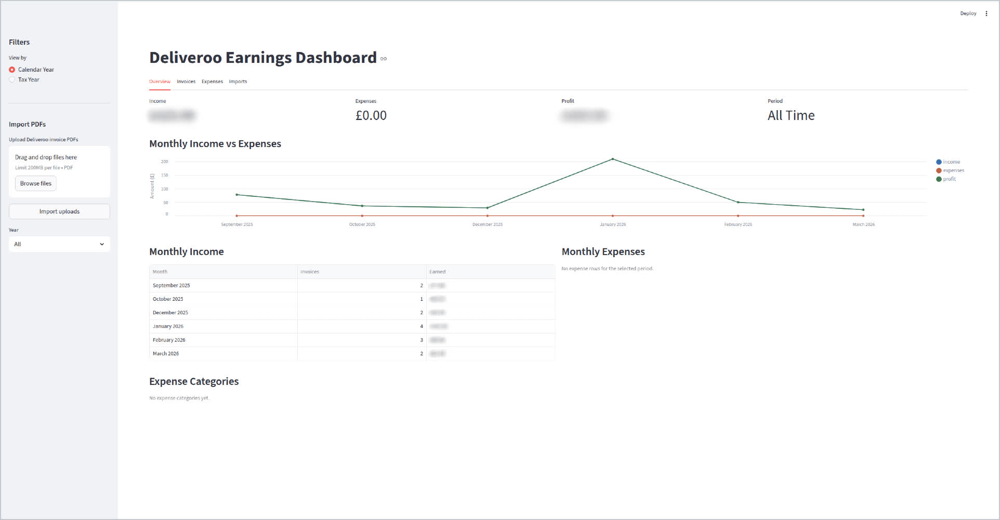

# Payslips

Extract and track earnings from Deliveroo self-billing invoice PDFs.

## Setup

```bash
python3 -m venv venv
source venv/bin/activate
pip install -r requirements.txt
```

### Database (PostgreSQL via Docker)

```bash
cp .env.example .env        # edit credentials if needed
docker compose up -d         # start PostgreSQL
```

### Gmail API (for auto-fetching invoices)

1. Go to [Google Cloud Console](https://console.cloud.google.com/)
2. Create a project (or use existing)
3. Enable the **Gmail API**
4. Go to Credentials > Create Credentials > OAuth 2.0 Client ID (Desktop app)
5. Download the JSON and save as `credentials.json` in the project root
6. On first run, a browser window will open for authentication

## Usage

Parse and display an invoice (no database):

```bash
python -m src.main parse path/to/invoice.pdf
```

Parse and save to database:

```bash
python -m src.main save path/to/invoice.pdf
```

Fetch invoices from Gmail, parse, and save to database:

```bash
python -m src.main fetch
python -m src.main fetch ./my_invoices   # save PDFs to a specific folder
```

Imported invoice PDFs are archived under `data/invoices/YYYY/MM/` so they stay
available for later tax records instead of only existing in a temporary fetch
folder.

View earnings summary:

```bash
python -m src.main summary             # all time
python -m src.main summary 2026        # calendar year 2026
python -m src.main summary --tax 2025  # UK tax year 2025/2026 (6 Apr - 5 Apr)
```

## Automation (Weekly Cron)

To auto-fetch invoices every Monday at 9 AM:

```bash
crontab -e
```

Add this line (update the path to your project):

```bash
0 9 * * 1 /path/to/payslips/scripts/fetch_weekly.sh
```

Logs are written to `logs/fetch.log`.

Automatic Gmail fetches only look back a rolling window from the newest saved
invoice by default, so once you are up to date it stops rescanning old months.
Set `FETCH_LOOKBACK_DAYS` if you want a wider or narrower window.

## Automation (systemd on a mini PC/server)

If you run this on your HP mini as a small server, you can use the included
systemd unit files instead of cron:

```bash
sudo cp scripts/payslips-fetch.service /etc/systemd/system/
sudo cp scripts/payslips-fetch.timer /etc/systemd/system/
sudo systemctl daemon-reload
sudo systemctl enable --now payslips-fetch.timer
sudo systemctl list-timers | grep payslips
```

The example service uses `/home/mo7muj/dev/payslips`. Update that path if your
project lives somewhere else.

## Dashboard

Launch the Streamlit earnings dashboard:

```bash
streamlit run src/dashboard.py
```

Dashboard features:
- Upload PDF invoices directly from the sidebar
- See import results for saved, duplicate, invalid, and failed files
- Track expenses with uploaded receipt files stored under `data/receipts/`
- View income, expenses, and profit together by calendar year or tax year

Docker Compose mounts the project's `data/` directory at `/app/data`, keeping
archived invoices and receipts on the host when the app container is replaced.
This directory is excluded from Git. Back it up alongside the PostgreSQL database.

If an existing app container already contains invoices or receipts, copy them to
the host **before** recreating it with this mount (run from the project root):

```bash
mkdir -p data
docker cp payslips-app:/app/data/. ./data/
docker compose up -d app
```

Skip the copy command for a fresh installation with no stored files.



## Running Tests

```bash
python -m pytest tests/ -v
```
